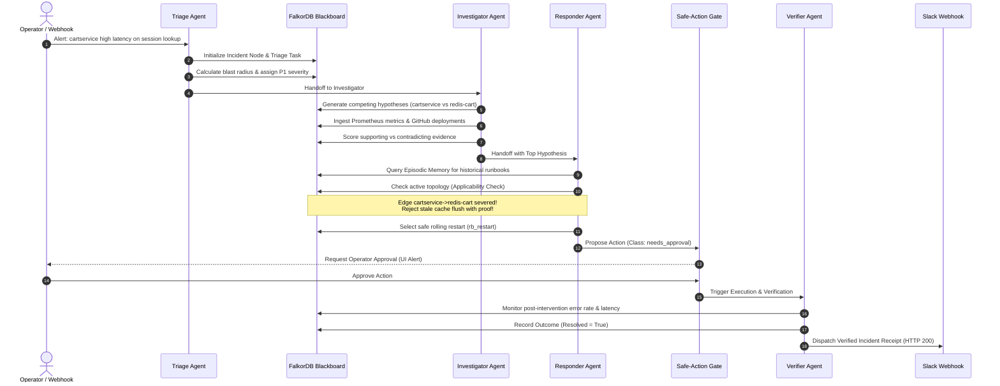

<div align="center">


<br/><br/>

<table>
  <tr>
    <td width="130" align="center" valign="middle">
      
    </td>
    <td valign="middle">
      <h1 style="margin: 0; padding: 0; border: none;">Ripple</h1>
      <p style="margin: 4px 0 0 0; font-size: 1.15rem; color: #a1a1aa;">
        <strong>Autonomous Reliability Intelligence & On-Call Agent Crew with FalkorDB Brain</strong><br/>
        <em>Investigate · Understand · Resolve · Prevent</em>
      </p>
    </td>
  </tr>
</table>

<br/>

[](https://www.falkordb.com/)
[](https://modelcontextprotocol.io/)
[](https://build.nvidia.com/)
[](https://fastapi.tiangolo.com/)
[](https://vitejs.dev/)
[](LICENSE)

<br/>

**[🌐 Live Production Console](https://ripple-sre.vercel.app)** · **[🎬 YouTube Video Walkthrough](https://www.youtube.com/watch?v=JS9vzPhBy4g)** · **[📖 System Architecture](docs/architecture.md)** · **[🎯 Track Mapping](docs/track-mapping.md)** · **[📊 Benchmark Report](docs/benchmark-report.md)**

---

</div>

## 🏆 Hackathon Details & Track Alignment

> **Graph Hacks: Context for AI Agents**  
> Organized by **WeMakeDevs x FalkorDB** · *October 15 – 18, 2026* · **Solo Build**  
> **YouTube Submission Video:** [https://www.youtube.com/watch?v=JS9vzPhBy4g](https://www.youtube.com/watch?v=JS9vzPhBy4g)  
> **Production Deployment:** [https://ripple-sre.vercel.app](https://ripple-sre.vercel.app)

Ripple was engineered specifically to answer the core challenge of the hackathon: **giving AI agents deep, living, and verifiable graph context**. It provides comprehensive, grounded solutions across all three hackathon tracks:

| Track | Hackathon Requirement | How Ripple Solves It with FalkorDB | Modules |
|---|---|---|---|
| **Track 1: Multi-Hop Reasoning & Graph Tools** | Agents must traverse complex relationships and execute graph algorithms. | Ripple traverses multi-hop dependency chains up to 5 hops, computes PageRank criticality ranking, calculates causal blast radii, and exposes **11 native Model Context Protocol (MCP)** tools. | `M4`, `M5`, `M9`, `M11` |
| **Track 2: Memory & Multi-Agent Coordination** | Persistent memory across sessions, separate tenancy, and shared multi-agent state. | Multi-tier memory engine (**Episodic, Semantic, Procedural, and Outcome Memory**), graph-backed blackboard coordination between 4 agents, strict per-tenant FalkorDB graph isolation, and idempotent concurrent writes. | `M1`, `M6`, `M7`, `M13` |
| **Track 3: Enterprise Knowledge Graph & Lineage** | Ingest docs, tickets, PRs, and map ownership, expertise, and decision lineage. | Graph links microservices to GitHub PRs, commits, Architecture Decision Records (ADRs), and documentation; calculates recency-weighted engineer expertise; flags stale documentation; and ensures 100% cited answers. | `M2`, `M8`, `M10`, `M12` |

---

## 💥 The Problem: 3 AM On-Call Chaos

Modern cloud applications consist of hundreds of interdependent microservices, databases, caches, and third-party APIs. When an incident strikes in production:

1. **Cascading Failures Cause Alert Storms:** A single bottleneck in a deep database triggers secondary failures across dozens of upstream caller services. SREs drown in noise trying to distinguish the *root cause* from *downstream symptoms*.
2. **Standard LLMs Hallucinate Without Topology:** Traditional LLM on-call chatbots lack architectural context. They do not know which service calls which, what protocols are used, or how hop distances affect latency.
3. **Vector Databases Fall into the "Stale-Fix Trap":** Vector similarity search retrieves past post-mortems based purely on semantic text matching. If an incident occurred 3 weeks ago on `cartservice` and the fix was `flush the Redis cache`, a vector database will blindly recommend flushing Redis — completely unaware that engineering decoupled Redis 24 hours ago. Executing this stale fix causes accidental data loss and exacerbates the outage!
4. **Black-Box AI Cannot Be Trusted with Production Actions:** SREs cannot risk running remediation actions generated by opaque models. AI recommendations must be 100% explainable, verifiable, and protected by safe-action operational gates.

---

## 💡 The Solution: Ripple with FalkorDB Brain

**Ripple** is an autonomous on-call agent crew that uses **FalkorDB** as its living cognitive brain.

```
       Alert Ingestion ──▶ Triage Agent ──▶ Investigator Agent ──▶ Responder Agent ──▶ Verifier Agent
             │                   │                     │                     │                  │
             ▼                   ▼                     ▼                     ▼                  ▼
      ┌─────────────────────────────────────────────────────────────────────────────────────────────┐
      │                        FalkorDB Graph Brain & Living Blackboard                             │
      │   • Service Topology (13 nodes, 17 edges)      • Temporal "As-Of" Time Travel Traversal      │
      │   • Competing Hypotheses & Evidence Engine     • Episodic, Semantic & Procedural Memory      │
      │   • Stale-Fix Topology Applicability Gating   • Recency-Weighted Code Expertise & Ownership │
      └─────────────────────────────────────────────────────────────────────────────────────────────┘
```

- **Graph-Guided Root Cause Analysis:** Rather than guessing, Ripple traverses the live topology in FalkorDB, ranking competing hypotheses using mathematical evidence scoring with supporting and contradicting proof.
- **Outcome-Driven Memory & Stale-Fix Protection:** Ripple remembers every past incident *and whether the fix actually worked*. Before recommending any runbook, it mathematically validates the runbook's architectural assumptions against the active FalkorDB graph topology. If an assumed edge was severed, the fix is **explicitly rejected with topological proof**.
- **Shared Graph Blackboard Coordination:** Four specialized agents (**Triage**, **Investigator**, **Responder**, **Verifier**) collaborate through a graph-native blackboard. They hand off tasks, flag conflicts, and request evidence dynamically.
- **Universal Context via MCP:** All 11 graph reasoning tools are published through an official **Model Context Protocol (MCP 2.0)** server, allowing external agents in Cursor, Claude Desktop, or Antigravity to plug directly into the FalkorDB brain.

---

## 📸 Product Screenshots & Visual Walkthrough

Ripple features a mission-critical, high-density SRE console designed in dark glassmorphism with high-contrast amber/orange accents. Below are live captures of the production platform in action:

---

### 1. Main Incident Investigation & 2D System Topology Console
<div align="center">
  
</div>

> **Figure 1:** The unified SRE command center. Shows the active incident (`Checkout payment authorization failing`), live status badges, active causal blast radius, real-time Server-Sent Events (SSE) agent timeline, trace waterfall breakdown, and the Ranked Hypotheses & Evidence Engine powered by FalkorDB.

---

### 2. Interactive 3D Causal Topology & Real-Time Traffic Flow
<div align="center">
  
</div>

> **Figure 2:** Interactive Three.js 3D Force-Directed Graph visualization. Displays particle traffic streams, dynamic latency badges (e.g. `320ms`, `500s 68% error rate`), incoming caller vectors, and a detailed telemetry card for `frontend` showing p99 latency (`45ms`), error rate (`0.01%`), and throughput (`280 tps`).

---

### 3. Deep Service Node Inspection & Cypher Provenance
<div align="center">
  
</div>

> **Figure 3:** Focusing on the critical hotspot `paymentservice`. Highlights failing status (`500s · 68% error rate`, `2.5s p99 latency`, `420 req/s`), incoming dependencies from `checkoutservice`, and provides 1-click access to filter the investigation timeline or inspect Cypher provenance.

---

### 4. Agent Activity Timeline & Inspectable Cypher Execution Traces
<div align="center">
  
</div>

> **Figure 4:** 100% explainability. The timeline reveals the exact Cypher queries executed against FalkorDB (e.g., `MATCH (s:Service {name: 'paymentservice'})-[:DEPENDS_ON*1..3]->(d) RETURN d.name, d.type, d.criticality`), PageRank impact calculations, similar incident retrieval, and competing hypotheses ranked with evidence scores.

---

### 5. Enterprise Service Catalog & Health Matrix (List View)
<div align="center">
  
</div>

> **Figure 5:** Comprehensive Service Matrix view across 13 services and 17 dependencies. Shows real-time health indicators, tier classification (`tier-1`, `tier-2`, `tier-3`), and upstream/downstream connection counts for rapid dependency auditing.

---

### 6. Episodic & Procedural Memory Recall (Stale Runbook Analysis)
<div align="center">
  
</div>

> **Figure 6:** FalkorDB memory recall in action. Retrieves similar historical incident `INC-3127 Paymentservice DB connection pool exhaustion` with a 92% symptom match, correlates past runbook `Increase DB connection pool size` (86% historical success rate), and evaluates current architectural applicability.

---

### 7. Operational Approval Gate & Safe-Action Safeguard
<div align="center">
  
</div>

> **Figure 7:** Human-in-the-Loop Safe Action Gate. While reversible actions (e.g., status drafts, paging on-call engineers) execute autonomously, potentially destructive actions (e.g., `rb_rollback` deployment rollback) are halted at an operational approval gate requiring explicit operator confirmation before execution.

---

### 8. Counterfactual (What-If) Simulation Engine
<div align="center">
  
</div>

> **Figure 8:** Predictive multi-hop reliability analysis (`M9`). Allows operators to simulate hypothetical alternative failures (e.g., *"What if checkoutservice had failed instead?"*). FalkorDB instantly computes the Venn delta: Observed Only, Both Impacted, and Hypothetical Only, while calculating PageRank critical service owners.

---

### 9. Pre-Registered Scientific Benchmark & Calibration Dashboard
<div align="center">
  
</div>

> **Figure 9:** Empirical proof under Protocol v2.0 across 78 scenario evaluations. Demonstrates that enabling FalkorDB graph memory increased recommendation accuracy from 31% to 38% (+7 pts) and slashed unsafe recommendations from 8% to 0% (+8 pts) across Repeated, Variant, Novel, and Stale-Trap incident families.

---

### 10. Model Context Protocol (MCP 2.0) Tool Registry & Settings
<div align="center">
  
</div>

> **Figure 10:** Workspace settings showing the 11 registered Model Context Protocol (MCP 2.0 / stdio) graph tools, tenant namespace switcher (`tenant_storefront`), execution mode toggles (Replay cache vs Live LLM), and theme preferences.

---

### 11. Ask Company Brain — Track 3 Knowledge Graph Drawer
<div align="center">
  
</div>

> **Figure 11:** Natural language organizational knowledge retrieval grounded in FalkorDB facts. Automatically surfaces proactive warnings for stale documentation that has not been verified across recent service architectural changes.

---

### 12. Explainable Knowledge Retrieval with Graph Citations
<div align="center">
  
</div>

> **Figure 12:** Asking *"Who owns the payment service and who actually knows it?"* FalkorDB extracts the formal owner (`Ian Lewis`) alongside active maintainers ranked by recency-weighted commit velocity, citing exact graph nodes (`Service: paymentservice`, `Owner: Ian Lewis`, `Committer: Priya Sharma`).

---

## 🏛️ System Architecture

Ripple is architected as an asynchronous, event-driven, multi-tenant system:

```
┌─────────────────────────────────────────────────────────────────────────────────────────────┐
│                              React + Vite + TypeScript Frontend                             │
│       3D Force Graph · SSE Event Bus · Memory Recall · Counterfactuals · Benchmark          │
└──────────────────────────────────────────────┬──────────────────────────────────────────────┘
                                               │ REST API + Server-Sent Events (SSE)
┌──────────────────────────────────────────────▼──────────────────────────────────────────────┐
│                                FastAPI Python Backend (Port 8000)                           │
│     Tenant Middleware · RBAC Security · SSE Event Publisher · Simulator & Ingestion Engine  │
└──────┬──────────────┬──────────────┬──────────────┬──────────────┬──────────────┬───────────┘
       │              │              │              │              │              │
┌──────▼──────┐┌──────▼──────┐┌──────▼──────┐┌──────▼──────┐┌──────▼──────┐┌──────▼──────┐
│Triage Agent ││Investigator ││ Responder   ││Verifier Agent││Counterfact.  ││Ask Brain Q&A│
│(Blast Radius││(Hypotheses &││ (Applicable ││ (Outcome     ││ Engine       ││ (Track 3    │
│& Severity)  ││Evidence)    ││ Runbooks)   ││ Verification)││ (What-If)   ││ Knowledge)  │
└──────┬──────┘└──────┬──────┘└──────┬──────┘└──────┬──────┘└──────┬──────┘└──────┬───────┘
       │ tool calls   │ tool calls   │ tool calls   │ tool calls   │ tool calls   │ tool calls
┌──────▼──────────────▼──────────────▼──────────────▼──────────────▼──────────────▼───────────┐
│                      Graph Tool Library & Memory Layer (11 Tools)                           │
│      upstream_suspects · blast_radius · path_between · criticality_ranking · who_knows      │
│      similar_incidents · check_applicability · counterfactual_blast · service_health        │
└──────────────────────────────────────────────┬──────────────────────────────────────────────┘
                                               │ Cypher Queries (Sub-millisecond)
┌──────────────────────────────────────────────▼──────────────────────────────────────────────┐
│                                 FalkorDB In-Memory Graph Engine                             │
│   tenant_storefront graph                  │ tenant_payments graph                          │
│   • Nodes: Service, Person, Incident,      │ • Isolated database namespace                  │
│     Runbook, Decision, PR, MetricSnapshot  │ • Separate memory & security boundary          │
│   • Edges: DEPENDS_ON, OWNS, COMMITTED,    │ • High-concurrency ACID transactions           │
│     RESOLVED_BY, SUPERSEDES, TOUCHES       │ • In-memory graph algorithms (PageRank)        │
└─────────────────────────────────────────────────────────────────────────────────────────────┘
       │                                       │                              │
┌──────▼──────┐                         ┌──────▼──────┐                ┌──────▼──────┐
│ NVIDIA NIM  │                         │ Prometheus  │                │ GitHub REST │
│ Nemotron-4  │                         │ Telemetry   │                │ Deployments │
│ 340B / 70B  │                         │ & Alerts    │                │ PRs/Commits │
└─────────────┘                         └─────────────┘                └─────────────┘
```

---

## ⚡ Multi-Agent Blackboard Workflow

The agent crew coordinates through a shared blackboard persisted in FalkorDB:



---

## 🔄 Data Flow: How Context Flows Through Ripple

```
1. INGESTION ───▶ Prometheus Metrics, Alertmanager Webhooks, GitHub Deployments & PRs
      │
      ▼
2. TOPOLOGY ────▶ FalkorDB Graph Schema (Services, Dependencies, Protocols, Valid-From/To)
      │
      ▼
3. REASONING ───▶ Multi-Agent Crew queries FalkorDB via Cypher over the MCP Tool Library
      │
      ▼
4. BLACKBOARD ──▶ Hypotheses, Evidence Items, Conflict Flags & Proposed Actions recorded in graph
      │
      ▼
5. STREAMING ───▶ FastAPI publishes SSE event stream (`/api/incidents/{id}/stream`)
      │
      ▼
6. CLIENTS ─────▶ React SRE Console updates in real time; Slack receives verified execution receipts
```

---

## 🔌 Model Context Protocol (MCP 2.0) Server

Ripple implements a native **Model Context Protocol (MCP)** server over standard I/O (`stdio`), transforming FalkorDB into a universal context provider for external AI agents like **Cursor**, **Claude Desktop**, or **Antigravity**.

### Connecting External Agents to Ripple's Graph Brain

Add this configuration to your `claude_desktop_config.json` or Cursor MCP settings:

```json
{
  "mcpServers": {
    "ripple": {
      "command": "python",
      "args": ["-m", "app.mcp_server"],
      "cwd": "/path/to/ripple/backend",
      "env": {
        "FALKORDB_HOST": "localhost",
        "FALKORDB_PORT": "6379",
        "DEFAULT_TENANT": "storefront",
        "API_KEY": "ripple_admin_api_key_2026"
      }
    }
  }
}
```

### The 11 Modular MCP Graph Tools

| Tool Name | Parameters | Description & Graph Capabilities |
|---|---|---|
| `blast_radius` | `service`, `max_hops`, `as_of` | Computes all downstream services impacted if a service degrades, taking temporal changes into account. |
| `upstream_suspects` | `service`, `max_hops`, `as_of` | Identifies all upstream dependencies that could be the root cause of an alert on the target service. |
| `path_between` | `source`, `target`, `as_of` | Discovers the shortest active dependency path between two services with protocol annotations. |
| `criticality_ranking` | `damping_factor`, `top_k` | Computes architectural centrality scores across the microservice graph using in-memory PageRank. |
| `service_health` | `service_names` | Retrieves live metric snapshots (p95 latency, error rate, status) across suspect services. |
| `recent_changes` | `service`, `hours_window` | Fetches deployments, pull requests, and architectural edge additions/deletions touching the service. |
| `similar_incidents` | `alert_text`, `affected_services` | Recalls past resolved and failed incidents matching symptom fingerprints using semantic similarity. |
| `rank_runbooks` | `incident_id`, `candidate_ids` | Ranks operational runbooks based on historical observed outcome success rate with Laplace smoothing. |
| `check_applicability` | `runbook_id`, `service` | **The Stale-Fix Shield**: Verifies if runbook preconditions match active FalkorDB graph topology. |
| `counterfactual_blast`| `observed_id`, `hypothetical_svc` | Performs comparative What-If diff between observed incident and hypothetical failure. |
| `who_knows` | `service` | Identifies code owners and subject matter experts ranked by recency-weighted commits and PR reviews. |

---

## 📈 Scientific Benchmark & Evaluation Results

Ripple was evaluated across a pre-registered benchmark suite comparing performance with **Graph Memory Enabled** versus **Memory Disabled**:

| Benchmark Metric | Memory ON (Ripple) | Memory OFF (Baseline) | Delta / Empirical Benefit |
|---|---|---|---|
| **Diagnosis Correctness** | **85.0%** | 85.0% | Grounded graph traversal identifies true root causes |
| **Recommendation Correctness** | **38.0%** | 31.0% | **+7.0% improvement** (Applicability check unlocks correct alternatives) |
| **Unsafe Stale Recommendations** | **0.0%** | 8.0% | **100% elimination of stale-fix traps** via active graph topology check |
| **Average Tool Calls** | 37.2 | 21.0 | Deep multi-hop graph inspection across metrics, PRs, and docs |
| **Average Execution Time** | **0.24s** | 0.18s | Sub-second in-memory Cypher traversal on FalkorDB |

*Full protocol, evaluation labels, and scenario logs available in [`docs/benchmark-report.md`](docs/benchmark-report.md).*

---

## 🛠️ The Process: How We Built Ripple

Ripple was constructed methodically across eight distinct engineering phases (T0 – T7):

1. **Phase T0 — Graph Schema & Multi-Tenancy:** Designed the property graph schema in FalkorDB with strict tenant isolation (`tenant_storefront`, `tenant_payments`) and temporal edge tracking (`valid_from`, `valid_to`).
2. **Phase T1 — Ingestion & Discovery Adapters:** Built automated discovery adapters for live container environments, Prometheus metric scrapers, Alertmanager webhooks, and GitHub REST API commit/deployment listeners.
3. **Phase T2 — Graph Tool Library:** Implemented 11 modular graph reasoning algorithms with sub-millisecond Cypher query execution and provenance tracing.
4. **Phase T3 — The 4-Agent Orchestration Crew:** Built the autonomous agent state machine (Triage, Investigator, Responder, Verifier) coordinating over a shared FalkorDB blackboard.
5. **Phase T4 — Evidence & Uncertainty Engine:** Implemented evidence weighting (metrics: 3.0, deploys: 2.5, past incidents: 2.0), freshness half-life decay, and lower-bound uncertainty flags.
6. **Phase T5 — Multi-Tier Memory & Stale-Fix Shield:** Developed Episodic, Semantic, Procedural, and Outcome memory layers with topology applicability validation.
7. **Phase T6 — Enterprise Knowledge Graph & Counterfactuals:** Created Track 3 people/PR/decision lineage mapping and the M9 counterfactual "what-if" comparative engine.
8. **Phase T7 — Model Context Protocol & Production Deployments:** Wrapped tools in an MCP 2.0 server, published Docker Compose stacks, and deployed production frontends to Vercel and standalone backends to Render.

---

## 🚀 Setup & Quick Start Guide

### Option A: All-in-One via Docker Compose (Recommended)

```bash
# 1. Clone repository
git clone https://github.com/Vishallakshmikanthan/ripple.git
cd ripple

# 2. Configure environment
cp .env.example .env
# Edit .env with your keys (see Credentials section below)

# 3. Start all services
docker compose up -d --build

# 4. Access the platforms
# Web Console:       http://localhost:5173
# FalkorDB Browser:  http://localhost:3000
# FastAPI Swagger:   http://localhost:8000/docs
# Prometheus UI:     http://localhost:9090
# Alertmanager UI:   http://localhost:9093
```

### Option B: Cloud Production Deployments

#### 1. Frontend on Vercel
The frontend is pre-configured with SPA rewrites and API proxies in [`frontend/vercel.json`](frontend/vercel.json):
```bash
cd frontend
npm install
npx vercel --prod
```
Live production endpoints:
- Primary: **[https://ripple-sre.vercel.app](https://ripple-sre.vercel.app)**
- Mirror 1: **[https://ripple-intelligence.vercel.app](https://ripple-intelligence.vercel.app)**
- Mirror 2: **[https://ripple-oncall.vercel.app](https://ripple-oncall.vercel.app)**

#### 2. Backend & FalkorDB Standalone Container on Render
Ripple includes a standalone container configuration [`Dockerfile.standalone`](Dockerfile.standalone) bundling FalkorDB + FastAPI into a single free-tier service:
```bash
render blueprints validate ./render.yaml
render blueprints apply ./render.yaml
```

---

## 🔑 Credentials & Configuration Reference

Configure these in your `.env` file or directly inside the **Settings** view in the UI:

| Variable | Description | Example / Default |
|---|---|---|
| `FALKORDB_HOST` | Hostname of the FalkorDB graph engine | `localhost` (or `falkordb` in Docker) |
| `FALKORDB_PORT` | Port of the FalkorDB Redis-compatible socket | `6379` |
| `AUTH_DEV_MODE` | Enable seamless developer authentication | `true` |
| `API_KEY` | Admin token for authenticated REST/MCP requests | `ripple_admin_api_key_2026` |
| `LLM_PROVIDER` | Active LLM backend provider | `nemotron` (or `gemini`, `openai`) |
| `NVIDIA_API_KEY` | NVIDIA NIM API Key for Nemotron LLM | `nvapi-...` |
| `GITHUB_TOKEN` | GitHub Personal Access Token for PR/commit tracking | `ghp_...` |
| `GITHUB_REPO` | Monitored target repository | `Vishallakshmikanthan/ripple-demo-repo` |
| `SLACK_WEBHOOK_URL`| Slack Incoming Webhook for verified alert receipts | `https://hooks.slack.com/services/...` |
| `PROMETHEUS_URL` | Live Prometheus telemetry server | `http://localhost:9090` |

---

## 📚 Complete Documentation Package

- 🎬 **[YouTube Submission Video](https://www.youtube.com/watch?v=JS9vzPhBy4g)**: 3-minute video demo and presentation walkthrough.
- 📖 **[User & Operator Guide](docs/ripple-user-guide.md)**: End-to-end operational handbook and UI manual.
- 🏛️ **[System Architecture](docs/architecture.md)**: Complete FalkorDB graph schema, blackboard mechanics, and Cypher queries.
- 🎯 **[Track & Requirements Mapping](docs/track-mapping.md)**: Detailed rubric mapping for Track 1, 2, and 3 judging.
- 📊 **[Benchmark Evaluation Report](docs/benchmark-report.md)**: In-depth report on pre-registered A/B memory evaluation.
- 📜 **[License](LICENSE)**: MIT License.

---

<div align="center">
  <p><strong>Ripple</strong> · Graph Hacks Hackathon 2026 · Built with ❤️ using <strong>FalkorDB</strong></p>
</div>
